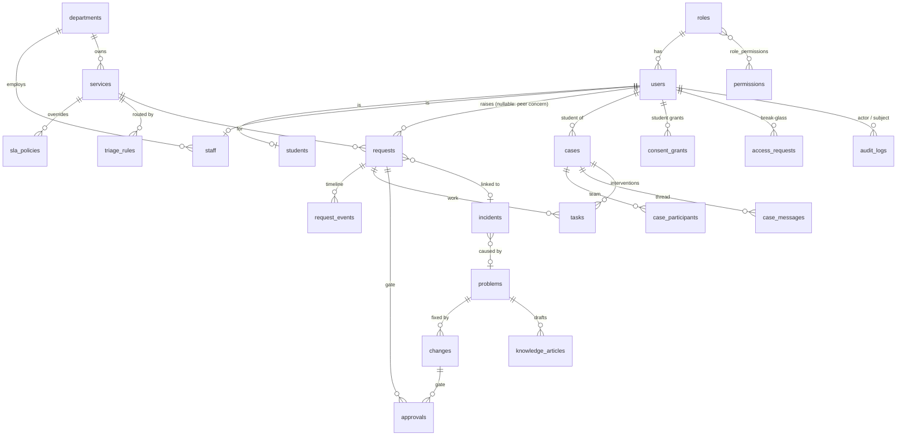

# Architecture

## Layers
```
frontend/js  → api.js (fetch + CSRF + refresh)  →  /api/v1  →  routers (app/api)  →  services (app/services)  →  models (app/models)  →  PostgreSQL
                                                     │ Pydantic validation            │ workflow rules, access rules      │ constraints, indexes, trigger
                                                     └ security/deps.py: auth + permission gate
```
* **Routers** are thin: validate input, check the permission gate, call a service, commit, serialise.
* **Services** own the rules (state machines, SLA, triage, consent, approvals) so they are testable without HTTP. Time-dependent functions take `now`.
* **`services/access.py`** holds *row-level* authorization as SQL criteria, shared by list and detail endpoints so they cannot disagree.
* **`api/serializers.py`** decides what a caller may see of a visible row (e.g. Command gets metadata only: no title, text, requester or timeline).
* Handlers `commit()` explicitly; a request that raises is rolled back.

## Data model (29 tables)
| Area | Tables |
|---|---|
| Identity & org | `users` · `roles` · `permissions` · `role_permissions` · `students` · `staff` · `departments` · `locations` · `refresh_tokens` |
| Catalogue & config | `services` · `sla_policies` · `triage_rules` · `assets` |
| Workflow | `requests` · `request_events` (timeline/comments) · `tasks` · `approvals` · `feedback` |
| ITSM | `incidents` · `problems` · `changes` |
| Care & consent | `cases` · `case_participants` · `case_messages` · `consent_grants` · `access_requests` (break-glass) |
| Other | `notifications` · `knowledge_articles` (full-text GIN index) · `audit_logs` (append-only) |


Integrity is enforced in the database, not only in code: unique case-insensitive email; one triage desk; one active case per student; a task has exactly one
parent; an approval has exactly one subject and a rejection needs a reason; enum values via CHECK; SLA resolution ≥ response; anonymous requests only for the peer channel;
`audit_logs` rejects UPDATE/DELETE/TRUNCATE. Migrations are tested up, down and up again, and the migrated schema is compared with the models (no drift).

## Request lifecycle
```
submit ─▶ triage (rules / student choice) ─▶ needs approval? ─yes▶ pending_approval ─approve▶ new
                                              │no                         └reject▶ rejected
                                              ▼
new ──acknowledge/start──▶ acknowledged ─▶ in_progress ─▶ resolved ─feedback helpful─▶ closed
 │  SLA clock starts at creation (or approval),            │ not helpful / student reopens → in_progress
 │  auto-assign to least-loaded dept staff                 └ no feedback for N days → closed (worker)
 └─ student may cancel while open
SLA: at-risk warning (default 75% of target) → breach: level 1 (dept heads notified) → overdue × multiplier (default 2): priority raised, Command notified
```
Every transition writes a timeline event, in-app notifications (never containing request text) and an audit row. Re-routing keeps the student's original wait time.

**Incident → Problem → Change.** Requests piling up at one location are *suggested* as an incident; staff create it (linking requests; one shared task list across departments).
A recurring incident opens a **problem** (root cause, workaround, known error). A **change** is raised to fix it; low risk needs the department head, medium/high needs Command; the requester can never approve their own
change. Completing a *successful* change resolves the problem and drafts a knowledge article (cause, workaround, resolution) for review. Resolving an incident can resolve its linked requests and ask students for feedback.

**Support cases.** The rule suggests; a consented human confirms or dismisses (with a reason). See [INTELLIGENCE.md](INTELLIGENCE.md) and [SECURITY.md](SECURITY.md#privacy-design).

## Access rules (row level)
| Data | Who can see it |
|---|---|
| A request (text, timeline) | the student · staff of the owning department (except sensitive services when the student withheld consent) · anyone holding an unexpired student-approved **break-glass** grant |
| A request (metadata only) | Command, across departments (status, owner, timing — no text, requester or timeline) |
| Admin | no request or case content at all |
| A support case | the student · participants **while the student's consent for them holds** · consented reviewers for *suggested* cases |
| Tasks | assignee, creator, same-department managers; Command for cross-department work; case tasks follow the case |
| Notifications, consent, access log | the owner only |
Role × permission grants: [RBAC_MATRIX.md](RBAC_MATRIX.md). Not-found is returned instead of forbidden when a record exists but is out of scope, so existence is not leaked.
